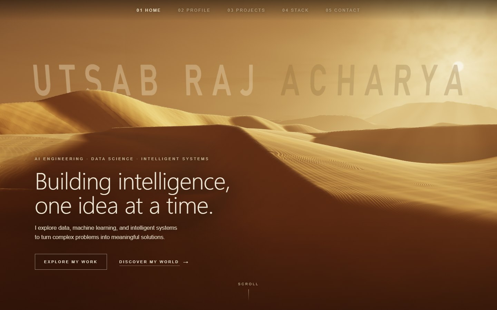
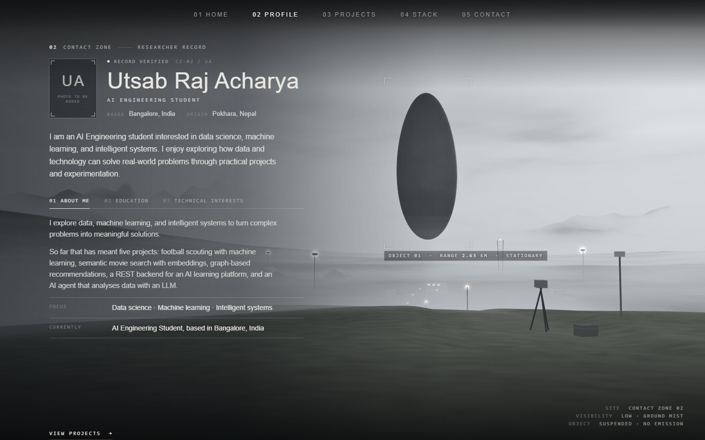
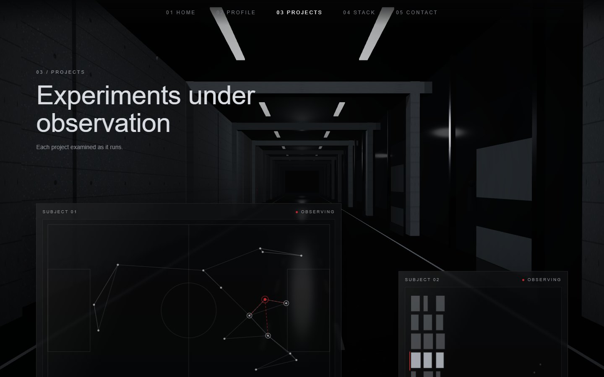
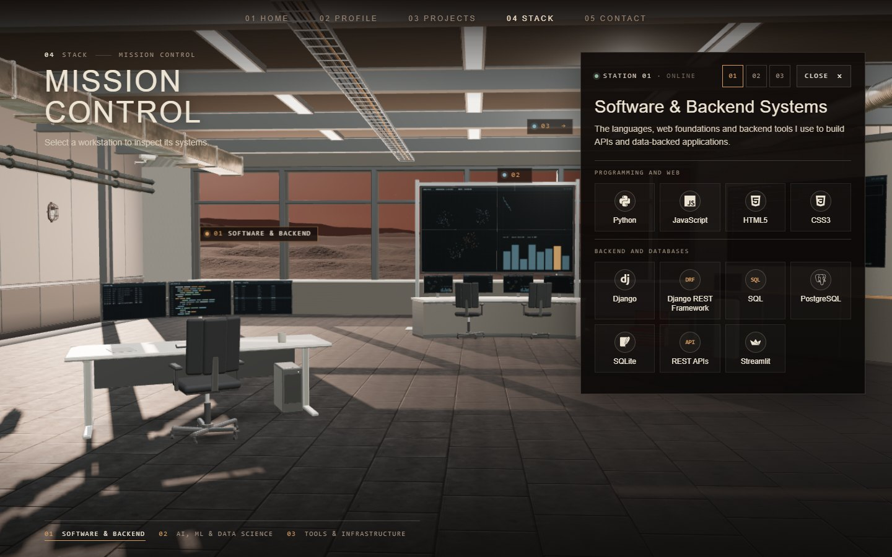
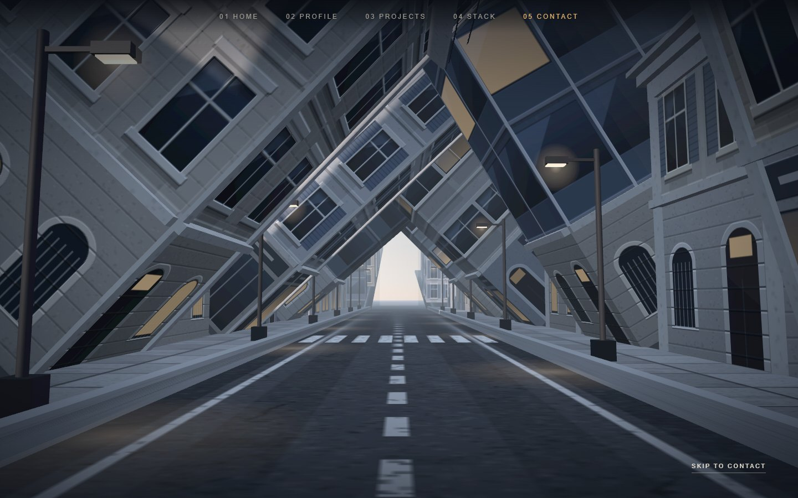

# Utsab Raj Acharya — Portfolio

Live at **https://www.utsabrajacharya.com.np/** (phones and tablets get the mobile edition; `/cinematic` and `/mobile` open either directly).

A single-page portfolio told as five cinematic, real-time 3D environments. Each section of the page is its own world, rendered
in the browser with three.js and built from code: procedural terrain, shaders, fog and lighting, plus a small set of
CC0-licensed models and textures in the Stack section.

**Home → Profile → Projects → Stack → Contact**



## The five sections

| Section | Inspired by | What you see |
|---|---|---|
| **Home** | *Dune* | A composed desert planet. The dunes are generated in a Web Worker, with baked light, moving sand, wind-blown streaks, heat shimmer and haze; the introduction is set into the landscape like a title card. |
| **Profile** | *Arrival* | A fog-filled valley with a vast dark structure above it, and a researcher's record: identification, introduction and a three-part dossier (About Me, Education, Technical Interests). |
| **Projects** | *Ex Machina* | A concrete-and-dark-glass research corridor. Each project is a panel with its own animated motif; open one for the full details and the GitHub link. |
| **Stack** | *The Martian* | Mission Control on Mars: a facility interior with an observation window over the Martian desert. Three workstations are the navigation, each opening its technology panel. |
| **Contact** | *Inception* | A city that folds over itself as you scroll, ending on the contact details. |

| | |
|---|---|
|  |  |
|  |  |

These are original environments; no film footage, characters or logos are used.

## Technologies

- **React 19**: page structure, section components and interface.
- **three.js 0.128 (WebGL 2)**: every 3D scene, with custom GLSL shaders. The version is pinned; all scenes are written against r128.
- **Vite 8**: development server and production build, with two small build plugins in `vite.config.js`.
- **simple-icons 11.14**: technology logos in Stack, plus the GitHub and LinkedIn icons in Contact.
- **Web Workers**: Home's terrain, height field and lighting are built off the main thread.
- **Poly Haven (CC0)** models, textures and HDRI in Stack; sources and licence in [public/stack-assets/LICENSES.md](public/stack-assets/LICENSES.md).

No web fonts, analytics or external requests.

## Features and interactions

- **Navigation:** a single site-wide navbar tints itself to match the active section; native scrolling everywhere. On phones all five sections stay in the bar.
- **Home:** "Explore my work" jumps to Projects, "Discover my world" and the scroll cue go to Profile.
- **Profile:** a short verification sequence on first entry, dossier tabs that work with the mouse or the arrow keys, and a resume download.
- **Projects:** panels open a details dialog, with the mouse, by tap or from the keyboard. Escape closes it.
- **Stack:** click a workstation in the 3D scene, its floating label or the station rail to open its technology panel. A label the open panel would cover moves beside it. Click anywhere outside the panel, press Escape or use Close to dismiss it. On phones the rail becomes a three-key console bar along the bottom.
- **Contact:** a scroll-driven folding-city sequence, email, GitHub and LinkedIn links, a copy-email button, and origin and current location.
- **Progressive loading:** Home is ready first. The other scenes are prepared in the background in page order, so a section is usually ready before you reach it, and one you're heading towards jumps the queue. Off-screen scenes don't render.
- **No freezes:** shaders compile in the background and large builds run in small steps. A quiet "Preparing scene" caption appears only if you arrive before a scene is ready.
- **Adaptive resolution:** every scene measures what a frame costs on the device (GPU time where the browser reports it) and, only when over budget, lowers its internal render resolution a little. Effects, fog, shadows and particles are never switched off, and phones build the same scenes as desktops unless the device reports very little memory.
- **Accessibility:** keyboard access throughout and `prefers-reduced-motion` support. If WebGL is unavailable, the sections fall back to static views without the 3D scenes.
- **Responsive:** desktop, tablet and phone layouts, portrait camera framings, and finger-sized touch targets.

Details of the loading strategy and before/after measurements are in [PERFORMANCE.md](PERFORMANCE.md).

## Project structure

```
index.html                    the portfolio (the only page in the production build)
home.html                     development-only preview of the Home section (npm run dev → /home.html, ?ui=0 hides the text)
vite.config.js                Vite config + build plugins: Home preload hints, gzip copies of Stack's binary assets
vercel.json                   HTTP caching on Vercel
public/
  _headers                    HTTP caching on Netlify / Cloudflare Pages
  stack-assets/               CC0 glTF models, textures and HDRI used by Stack (with LICENSES.md and manifest.json)
src/
  main.jsx, App.jsx           React entry; navbar + the five sections in order
  home-preview.jsx            entry of home.html
  styles/global.css           page-level reset
  navigation/                 section registry, active-section tracking, scrolling, progressive scene loading
  three/                      background shader compilation, pacing of background work, adaptive render resolution
  components/
    Navbar.jsx                site-wide navbar
    SceneLoader.jsx           "Preparing scene" caption
    HomeSection.jsx    + home/       Arrakis desert (design notes in home/INTEGRATION.md)
    ProfileSection.jsx + profile/    the Contact Zone
    ProjectsSection.jsx + projects/  Ex Machina research facility
    TechStackSection.jsx + stack/    Mission Control on Mars
    ContactSection.jsx + contact/    Inception folding city
  assets/profile/             place for an optional portrait (see its README.txt)
docs/
  screenshots/                the screenshots in this README
  home/                       renders of the Home section at several sizes, plus close-ups
  performance/                before / after / difference screenshots from the performance work
  responsive/                 phone and tablet screenshots, before / after the responsive work
PERFORMANCE.md                performance audit, changes, measurements and deployment notes
```

Each section's styles are scoped under its own root class, and its scene code lives in the folder named after it.

### Editing content

| What | Where |
|---|---|
| Projects (title, description, features, tech, GitHub links) | `src/components/projects/projectsData.js` |
| Stack stations and technologies | `src/components/stack/stackData.js` (add a logo export to `stack/icons.js`) |
| Email, GitHub, LinkedIn, locations | `src/components/contact/ContactConfig.js` |
| Profile (photo, education, interests, resume file name) | `src/components/profile/profileData.js` |

## Getting started

Requires **Node.js 20.19+ or 22.12+** (Vite 8's minimum) and npm.

```bash
npm ci             # install the exact versions from package-lock.json
npm run dev        # development server at http://localhost:5173
```

## Production build

```bash
npm run build      # outputs dist/
npm run preview    # serves dist/ at http://localhost:4173
```

## Environment variables

None are needed. The site has no API keys, backend or secrets. If some are added later, keep them in a `.env` file (ignored by
Git) and commit a `.env.example` with placeholder values. Vite exposes only variables prefixed with `VITE_` to the browser,
so never put a secret in one.

## Deployment

The build is a static site: deploy the `dist/` folder to any static host.

- **Netlify or Cloudflare Pages:** build command `npm run build`, publish directory `dist`. `public/_headers` sets caching.
- **Vercel:** framework preset "Vite", output directory `dist`. `vercel.json` sets caching.
- **GitHub Pages or a sub-path:** build with `npx vite build --base=/<repository-name>/` and publish `dist/`.
- **nginx or Apache:**
  - Mirror the rules in `public/_headers`: hashed `/assets/` files are immutable for a year.
  - Enable gzip or Brotli for `js`, `css`, `html`, `json` and `gltf`.
  - Serve the `.gz` files in `stack-assets/` without a `Content-Encoding` header; the page inflates them itself.

After deploying, check DevTools: `/assets/*` should be served as `immutable`, Stack's `.bin.gz` and `.hdr.gz` files should load
with status 200, and the console should be clean. More detail is in [PERFORMANCE.md](PERFORMANCE.md#8-deploying).

## Licence

No licence has been chosen for the portfolio code yet, so all rights are reserved by default. The third-party assets in
`public/stack-assets/` are CC0 1.0 (public domain), from [Poly Haven](https://polyhaven.com); see
[LICENSES.md](public/stack-assets/LICENSES.md).
